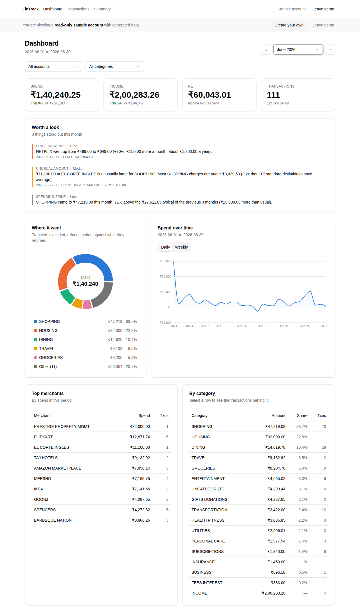
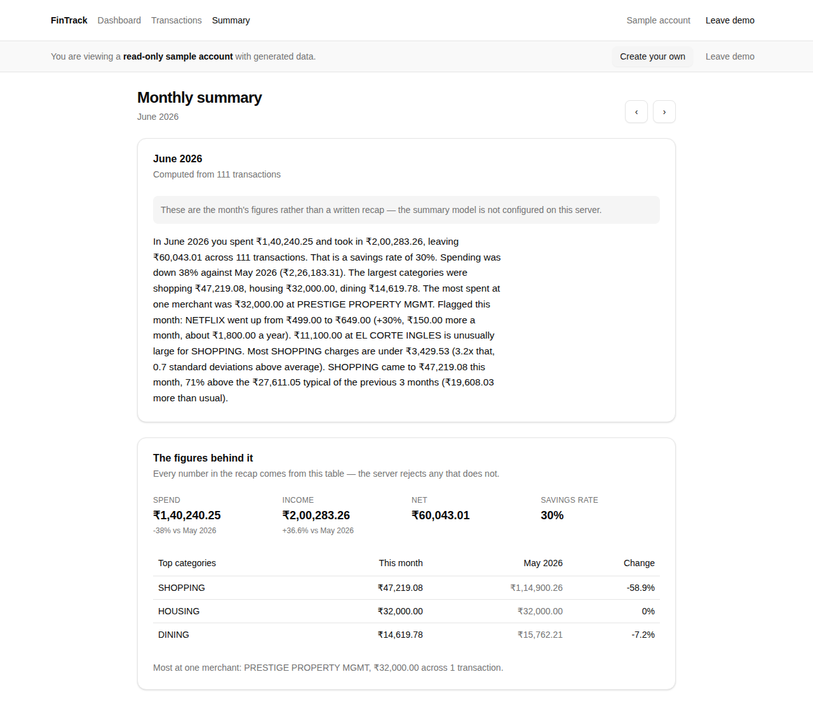
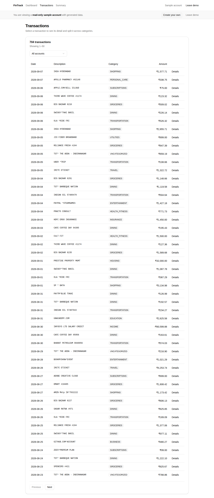
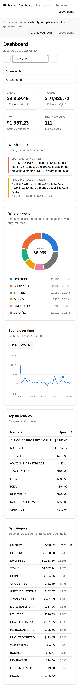

# FinTrack

Reads a bank CSV export, works out what each charge actually was, and shows you
the month — including the parts that are easy to get wrong: transfers between
your own accounts, refunds against the thing they refunded, and one charge split
across categories.

Categorization is deterministic first and a language model only for the tail
that rules cannot settle, so the same statement always produces the same answer
and the model bill scales with the number of unfamiliar merchants rather than
the number of transactions.

**[See it with sample data](#demo-mode)** — no signup, read-only.

## Screenshots

|                                                                                                                |                                                                                                               |
| -------------------------------------------------------------------------------------------------------------- | ------------------------------------------------------------------------------------------------------------- |
|                                                                    |                                                               |
| **Dashboard** — spend by category with transfers excluded and refunds netted, plus the anomalies worth a look. | **Monthly summary** — a plain-English recap generated from computed figures, never from raw transaction rows. |
|                                                              |                                                               |
| **Transactions** — filter, inspect, recategorize, split one charge across categories.                          | **Mobile** — the same dashboard at 390px.                                                                     |

<sub>Captured from the demo account; the landing page is at
`docs/screenshots/landing.png`.</sub>

## What it does

- **Imports** a CSV or Excel (XLS/XLSX) export, or a PDF statement: account
  details above the table, separate debit and credit columns, day-first dates,
  noisy merchant strings. Duplicates from a bank sync glitch are flagged for you
  to resolve, never dropped silently.
- **Categorizes** with a rule engine over normalized merchant names, falling
  back to Claude only for merchants no rule matches — one call per unknown
  merchant, cached, not one per transaction.
- **Learns** from a correction: recategorizing a merchant writes a rule scoped to
  you, and a re-import never overwrites what you decided.
- **Explains the month**: spend by category, top merchants, spend over time, with
  transfers excluded and refunds netted against what they returned.
- **Flags what changed** with plain statistics — unusual amounts, category spend
  spikes, subscription price rises, newly-appearing recurring charges.
- **Writes a recap** in plain English from the computed figures only.

Measured results are in [RESULTS.md](./RESULTS.md); the full report behind them
is [docs/ACCURACY_REPORT.md](./docs/ACCURACY_REPORT.md), and the edge cases each
have a named test in [docs/EDGE_CASES.md](./docs/EDGE_CASES.md).

## Tech stack

|            |                                                                                                         |
| ---------- | ------------------------------------------------------------------------------------------------------- |
| **Client** | React 19, Vite, TypeScript, Tailwind CSS v4, shadcn/ui, React Router 7, TanStack Query, axios, Recharts |
| **Server** | Node.js 20+, Express 5, TypeScript, Prisma 7, PostgreSQL, Zod, SheetJS (Excel import)¹                  |
| **Auth**   | Google Sign-In or email/password; JWT in memory + rotating httpOnly refresh cookie, bcrypt              |
| **AI**     | Anthropic SDK (`claude-opus-5`), for merchant categorization fallback and monthly summaries             |
| **Tests**  | Vitest + Supertest (server), Vitest + Testing Library (client)                                          |

<sub>¹ SheetJS is installed from `cdn.sheetjs.com`, not npm: the `xlsx` package on
npm stopped at 0.18.5, which has published security advisories. The lockfile
pins the tarball's checksum, so `npm ci` still verifies exactly what it installs.
To upgrade, install the newer tarball URL from that site.</sub>

## Architecture

Two independently deployed services:

```
  Browser
     │
     ├── static SPA          client/  → Vite build on a CDN (Vercel/Netlify)
     │                       VITE_API_BASE_URL points at the API
     │
     └── XHR (credentials)   server/  → Node web service (Render/Railway)
                             CORS_ORIGIN allows exactly the client's origin
                                │
                                ├── PostgreSQL (Neon/Supabase) via Prisma
                                └── Anthropic API
```

The client is static files with no server of its own; every request that needs
data is a cross-origin XHR carrying a bearer token, plus the refresh cookie on
`/api/auth`. Nothing but `VITE_`-prefixed values reaches the browser bundle.

The full data model, the categorization pipeline and the edge cases it is built
around are in [PROJECT_CONTEXT.md](./PROJECT_CONTEXT.md); the phased build plan
is in [IMPLEMENTATION_PLAN.md](./IMPLEMENTATION_PLAN.md).

## Running it locally

Requires **Node.js 20.19+** (22 recommended), **npm 10+**, and a **PostgreSQL
14+** database. About five minutes from a fresh clone.

### 1. Install

```bash
git clone https://github.com/sriswasthik/fintrack.git
cd fintrack
npm install                       # installs both workspaces from the root lockfile
```

### 2. Configure

```bash
cp server/.env.example server/.env
cp client/.env.example client/.env
```

Open `server/.env` and set two things:

- `DATABASE_URL` — your Postgres connection string. If you have Docker and no
  Postgres, this gets you one:
  ```bash
  docker run --name fintrack-db -e POSTGRES_PASSWORD=postgres \
    -p 5432:5432 -d postgres:16
  ```
  and the default `DATABASE_URL` in `.env.example` already points at it.
- `JWT_ACCESS_SECRET` and `JWT_REFRESH_SECRET` — any two random strings:
  ```bash
  openssl rand -base64 32   # run twice, paste one into each
  ```

`ANTHROPIC_API_KEY` is optional. Without it everything works except the LLM
categorization fallback and the written monthly summary, which degrades to a
generated figures-only recap rather than failing. With it, every import runs the
fallback over the merchants the rules could not settle; set
`AI_CATEGORIZATION=off` to keep merchant names on the server instead. A PDF in a
layout no built-in reader knows is transcribed by the model from its transaction
rows alone, with account numbers and other identifiers masked; set
`AI_STATEMENT_READER=off` to refuse such a file instead.

### 3. Set up the database

```bash
npm run db:generate --workspace server   # generate Prisma Client (no database needed)
npm run db:migrate  --workspace server   # create the schema
npm run db:seed     --workspace server   # load 704 synthetic transactions
```

Prisma Client is generated code and is not committed, so `db:generate` has to
run after a fresh clone and after any schema change.

### 4. Run both services

```bash
npm run dev        # API on :4000 and the Vite dev server on :5173, together
```

Open <http://localhost:5173>. The landing page shows whether it can reach the
API. Create an account, then import `test-data/synthetic_transactions.csv` from
the Import page to see the pipeline run.

To skip the signup, turn on demo mode instead — see below.

### Scripts

Run from the repo root; any of them can be scoped with `--workspace server` or
`--workspace client`.

| Command             | What it does           |
| ------------------- | ---------------------- |
| `npm run dev`       | Both services together |
| `npm run build`     | Builds both workspaces |
| `npm run lint`      | ESLint over both       |
| `npm run typecheck` | `tsc` over both        |
| `npm test`          | Vitest in both         |
| `npm run format`    | Prettier over the repo |

Server-only utilities: `db:seed`, `db:migrate`, `db:deploy`, `db:generate`,
`demo:seed`, `rules:apply`, `eval:categorize`, `anomalies:detect`,
`summary:month`, `accuracy:report`.

## Demo mode

A no-signup, read-only session on a shared sample account, for a visitor who
wants to look before creating anything.

```bash
npm run demo:seed --workspace server   # loads and fully processes the sample account
```

Then set `DEMO_MODE=on` in `server/.env` (or in the deployment's environment)
and restart. `POST /api/auth/demo` will hand any caller a read-only session, and
the client shows a **See it with sample data** button.

- It is **off by default**. An instance holding somebody's real statements has
  no business issuing sessions to anonymous callers, so it must be turned on
  deliberately.
- The session is **read-only, enforced server-side** by middleware in front of
  every data route — not by hiding buttons. The UI hides them too, but that is a
  courtesy, not the control.
- `demo:seed` runs the whole pipeline once at deploy time — categorization,
  anomaly detection, and one summary per month — so demo traffic can never
  trigger a model call.

## Deploying

Two services, deployed separately, each pointed at the other's URL.

### Server → Render or Railway

`render.yaml` and `railway.json` in the repo root describe the service, so
pointing either platform at this repository is most of the work.

Both run migrations as part of the deploy, before the new instance starts
serving:

```
build:  npm ci && npm run db:generate --workspace server && npm run build --workspace server
deploy: npm run db:deploy --workspace server && npm run start --workspace server
```

`db:deploy` is `prisma migrate deploy` — it applies committed migrations and
never generates or resets one, which is the difference that makes it safe
against a live database.

Set these in the platform's environment:

| Variable             | Value                                                            |
| -------------------- | ---------------------------------------------------------------- |
| `DATABASE_URL`       | Postgres connection string from Neon or Supabase                 |
| `ANTHROPIC_API_KEY`  | Your key                                                         |
| `JWT_ACCESS_SECRET`  | 32+ random bytes (`render.yaml` generates these for you)         |
| `JWT_REFRESH_SECRET` | 32+ random bytes                                                 |
| `CORS_ORIGIN`        | The deployed client's origin, e.g. `https://fintrack.vercel.app` |
| `NODE_ENV`           | `production`                                                     |
| `DEMO_MODE`          | `on` only on a demo-only instance; `render.yaml` sets `off`      |

`NODE_ENV=production` is what makes the refresh cookie `Secure; SameSite=None`,
which is required for it to travel between two different HTTPS origins — and is
why both services must be on HTTPS in production.

### Client → Vercel or Netlify

`vercel.json` and `netlify.toml` are both here; use whichever platform you
prefer, not both. Each builds `client/` with Vite, publishes `client/dist`, and
rewrites all paths to `index.html` so a reload on `/dashboard` is not a CDN 404.

Set one environment variable:

| Variable            | Value                                                               |
| ------------------- | ------------------------------------------------------------------- |
| `VITE_API_BASE_URL` | The deployed API's origin, e.g. `https://fintrack-api.onrender.com` |

Then set `CORS_ORIGIN` on the server to this deployment's URL. The two point at
each other; the first deploy of each is done before the other's URL exists, so
expect to set one variable and redeploy once.

### After deploying

```bash
curl https://<api-host>/api/health            # {"status":"ok","demo":false}
```

Check the service's startup log for `[config]` lines. Each one names a missing
or risky setting — no mail provider (password reset unavailable), no
`CORS_ORIGIN`, no Anthropic key, demo mode on — and says what it costs.

Then open the client URL: the landing page reports whether it can reach the API,
which is the fastest way to tell a CORS or `VITE_API_BASE_URL` mistake from a
broken build.

### Before you store real statements

- **No `[config]` warnings** in the startup log, or only ones you have decided
  to accept.
- **`DEMO_MODE` is off.** A demo belongs on its own instance and database.
- **Email works.** Request a password reset for your own address and follow the
  link. Without a mail provider, nobody who forgets a password can get back in.
- **You have decided what may reach Anthropic.** `AI_CATEGORIZATION` sends
  merchant names; `AI_STATEMENT_READER` sends the transaction rows of a PDF no
  built-in reader knows, with identifiers masked. Either can be `off`.
- **Backups are on, and you have restored one.** They are a setting of the
  database host, not of this app: check that your Neon or Supabase plan keeps
  backups or point-in-time restore for long enough, then restore into a scratch
  database once, so the first restore is not the one that matters.
- **You know where the logs are.** Every request is logged with an ID, and an
  unexpected error shows the person a short reference, e.g.
  `(reference 3f9c2a1b)`. Searching the platform's logs for it finds the
  request and the stack trace. Query strings and request bodies are never
  logged.

## Environment variables

Copy the `.env.example` files and fill them in — never commit a real `.env`.

- `server/.env` — `DATABASE_URL`, `ANTHROPIC_API_KEY`, `AI_CATEGORIZATION`,
  `AI_STATEMENT_READER`,
  `JWT_ACCESS_SECRET`, `JWT_REFRESH_SECRET`, `CORS_ORIGIN`, `PORT`, `DEMO_MODE`,
  `DEMO_USER_EMAIL`
- `client/.env` — `VITE_API_BASE_URL`

Only `VITE_`-prefixed variables reach the browser bundle. Secrets belong in
`server/.env` only, and the client build is checked against that: see the
Phase 9 pull request for the scan.

## Layout

npm workspaces monorepo. ESLint and Prettier are configured once at the root
(`eslint.config.mjs`, `prettier.config.mjs`); each workspace extends those.

```
client/   React SPA          → :5173 in dev
server/   Express REST API   → :4000 in dev
docs/     Edge cases, accuracy report, screenshots
test-data/  Synthetic CSVs used by the tests and the accuracy report
```
